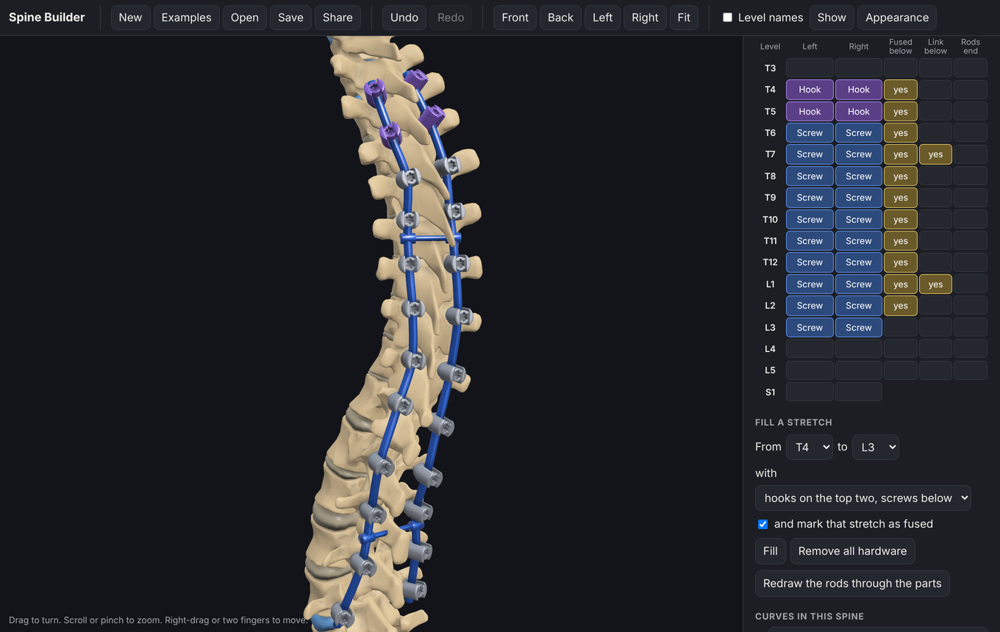
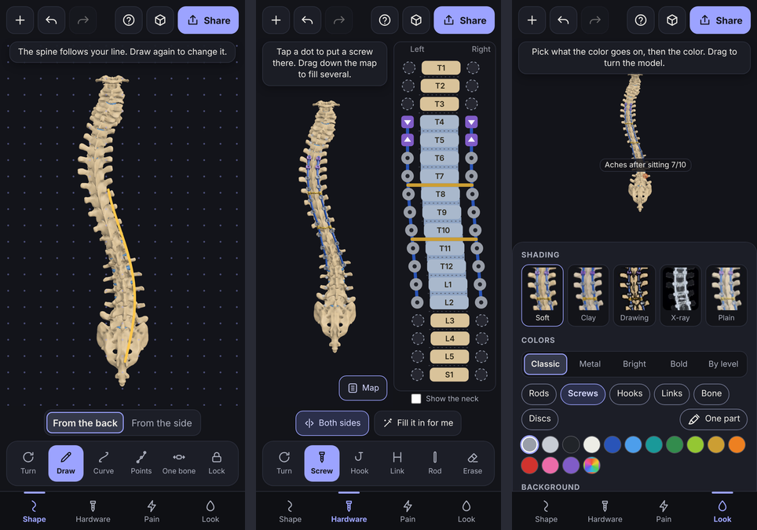
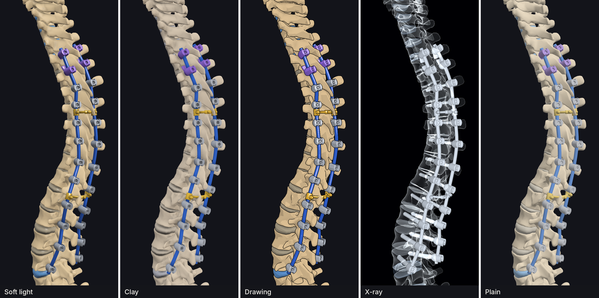

# Spine Builder

A free tool for people with scoliosis or a spinal fusion to build a 3D sketch of their own spine,
in the browser, on their own device.

You start from a basic spine and shape it until it looks like yours: the curve, the fused part,
the rods, screws and hooks. The result is something to look at, turn around and show to other
people. It is a sketch for understanding and conversation. It does not measure and it does not
diagnose.

## Use it

**Online.** At [Spine-Design.com](https://spine-design.com).
[docs/hosting.md](docs/hosting.md) says how to put up a copy of your own.

**On your own computer.** No install and no internet connection needed.

1. On the page of this repository, press **Code** and then **Download ZIP**.
2. Unzip it.
3. Double-click `index.html` in the folder.

That one file is the whole app. It opens in any current browser.

## Private by design

The site is a set of plain files. There is no account, no tracking, no database and no server
that keeps anything.

- The page does not send what you build anywhere. It also carries a rule that stops it from
  contacting any server once it is open, and that rule is checked by your browser, not by us.
- Files you open are read by your own browser and go nowhere. That goes for a picture of an
  X-ray too: it is held in the memory of the page while you trace over it, and it is not
  part of the sketch, a saved file, a link or a saved picture.
- A share link carries the sketch inside the address itself, in the part after the # sign.
  Browsers do not send that part to a web server. Whoever gets the link gets the whole sketch,
  with its name, its pain points and its notes, so send it only to people who should see those.
- On your device the app keeps two small settings: how you set the look, and whether you asked
  not to see the opening note again. Nothing about your spine is kept. Close the page without
  saving and the sketch is gone.
- Like any website, the service that hosts a copy can see that a device asked for the page.
  It does not see what you do there.

If you share a picture or an X-ray later on, check its edges first. X-rays often carry a name
and a date of birth in the margins. [PRIVACY.md](PRIVACY.md) has the same points in one place.
The site has them as a page, [privacy.html](privacy.html), next to its
[terms of use](terms.html) and a page on [accessibility](accessibility.html).

## What it does

Milestone 2 of 5, the builder, is done. What works today:

- The **spine file**, one small JSON document that holds a whole spine (see
  [docs/spine-file.md](docs/spine-file.md)).
- It **opens on a normal spine** and offers a sheet of **shapes to start from**: fifteen
  others, in groups. The common patterns of sideways curves (one curve in the chest, two, an S
  shape, three, one in the lower back, a long C shape), round and flat backs seen from the
  side, and spines after surgery, with screws, with hooks and screws, with one old-style rod,
  and one real spine. They are made-up shapes of common patterns, not a diagnosis.
  [docs/sources.md](docs/sources.md) says where the patterns were looked up. **New** in the
  top bar brings the sheet back.
- **One page, four things to work on.** **Shape**, **Hardware**, **Pain** and **Look** are
  always in the same place: along the bottom of a phone, in the middle of the top bar on a
  wide screen. Each has a few tools with a picture and a word, and one tool is in hand at a
  time. One line over the model says what a press does with that tool. Whatever is selected,
  and every tool that works with sliders, shows a card: in place of the tools on a phone, in
  a column beside the model on a wide screen. Undo, Redo, Guide, View and Share are always in
  the top bar.
  The same page serves a phone, a tablet and a desktop, with no setting to choose between
  them.

  

- **Turn is a tool.** With any other tool in hand a drag does the work of that tool, so the
  model never turns by accident. Two fingers, the scroll wheel and the right mouse button zoom
  and move the picture whatever is in hand, and the View buttons look from the back, the
  side or the front.
- **Real bone shapes.** The vertebrae and the sacrum are real anatomy, from the open
  BodyParts3D models, resized to the body size of each level. The simple bones drawn from
  measurements are still there, one tick away under Look, More, and stand in for any level
  the real set lacks. See [NOTICE.md](NOTICE.md) for the source and its licence.
- **Draw.** The quick way to shape a spine, and the tool in hand when the page opens: drag a
  line over the model with a finger or the mouse, from the back or from the side, and the
  spine takes the shape of the line.
- **Curve.** Pick a part of the spine by name (neck, chest, low back or the whole of it), or
  tap any two vertebrae, and bend that stretch with four sliders: sideways, round or flat,
  twist and lean. Each slider says what it is set to in words. The stretch can also be
  dragged on the model, and on a wide screen each slider has a box for the number.
- **Points.** A line that stays on the model. Drag its points and the spine follows, tap the
  line to add a point, remove one you do not need.
- **One bone:** tap a vertebra, then move it, turn it or resize it with handles on the model,
  the way 3D programs do it (arrows to move, rings to turn, knobs to resize), or with
  sliders. Moving it bends the spine around it. Turning it swings the whole spine above along
  with it, like bending at that joint.
- **Lock.** Lock vertebrae so they stay where they are while you draw, move the line or slide
  blocks: tap them on the model, or lock the neck, the chest or the low back in one press.
  That way one section can be worked on without losing the rest.
- **X-ray.** Open a photo or a saved picture of an X-ray, taken from the back or from the
  side, and trace over it. The picture lies over the model and turns with it, or stands
  beside it. Drag a line up the spine on the picture, or tap a few spots along it, say
  which two vertebrae the trace runs between, and press Fit: the picture is given the size
  that makes the traced line as long as that part of the spine, and the spine is laid along
  the line. After that a spot can be dragged and the spine follows, or any other tool takes
  over with the picture still there to check against. The picture can be made brighter and
  harder, its black can be made see-through so only the bone stays, and it can be moved,
  resized, turned and flipped left to right with one button (films are often shown as if you
  face the person). The app does not read the picture or measure it. The picture stays in the memory
  of the page: it is not saved with the sketch, not put in a link and not in a saved
  picture.
- **Blocks**, on a wide screen. Every vertebra as a block in a column beside the model, seen
  from the back or from the side. Slide a block sideways and its neighbours follow in a
  smooth bulge. Good for small, plain curves.
- **Fused parts are stiff.** Say which part is fused: a tick on the Curve card, a tick on
  the card of a vertebra, or "Fused, stays stiff" with the Rod tool. That stretch is drawn in
  a cooler colour while the shape is worked on, keeps its shape and moves as one block. Bend
  the spine and the bend goes into the joints that are still free, which shows what a fusion
  leaves to move.
- **Hardware on a flat map beside the model.** The tools are Screw, Hook, Link, Rod and
  Erase. With one in hand, tap the dots of the map or the soft marks on the model, or drag
  down the map to fill several. The model follows every tap. **Both sides** puts the same
  part on the other side of the vertebra, so one tap does a pair. The Map button puts the
  map away when the model needs the room.
- **Rods from part to part.** With the Rod tool, tap a screw or a hook, then another one on
  the same side, and a rod runs between the two. That works on the map and on the model. So
  one spine can have two or more separate fusions, each with rods of its own, say T4 to T7
  and L1 to L4. "Rods through all parts" does it in one press: a rod down each side, and
  groups of parts that are three or more bare vertebrae apart get rods of their own. A rod
  is ended by a tap between two of its parts on the map or by a tap on the rod on the model,
  and joined again the same way. Until the Rod tool is used the parts stand without rods.
- **Soft marks show where to tap.** The tool in hand marks its places, on the map and on the
  model: the empty spots for a screw or a hook, the gaps that can take a cross-link (it
  needs a rod on both sides), the parts a rod can run from. The marks are not in saved
  pictures and are never printed.
- **Which block is which bone.** Tap a vertebra on the model and its block lights up on the
  map or on the chart of blocks. Press a block and its bone lights up on the model. With a
  mouse, pointing is enough.
- **Fill it in for me:** three questions. Where is the fusion, what holds it (screws, hooks
  on top, screws on every other vertebra or hooks) and how many cross-links. One button puts
  it all on.
- **Select and change.** With Turn in hand, tap any part on the model or on the map to
  select it. Its card turns a hook up or down and removes it, and behind "More" changes the
  size of a screw. A selected screw or hook can be dragged over the bone, and a selected rod can be
  dragged to bend it. Only what is selected can be dragged, so turning the model never moves
  a part. Tap a vertebra for a card that sets what its left and its right side carry. On a
  desktop, Shift and a click select several parts: drag one of several selected screws or
  hooks along the spine and the others move with it, vertebra by vertebra.
- **Rods that stay believable.** A rod is drawn as one smooth bar through its screws and
  hooks, in their order along the spine, so it cannot zigzag. A part that is dragged out of
  line stops where the rod could no longer follow, and a bend made by hand stops at what a
  rod could take.
- **Colours, all in one place.** Every colour is set under Look. Four ready-made sets colour
  all the hardware in one press, and "By level" gives the parts of each vertebra a colour of
  their own. Below them, pick what a colour goes on (rods, screws, hooks, cross-links, bone or
  discs) and then one of fourteen colours, or any other colour. "One part" is a brush: pick a
  colour, then tap single parts or vertebrae on the model to paint them. The last thing done
  is what shows: a set or a colour for a kind replaces the colours painted on those parts, so
  nothing set earlier stays behind unseen, and one line says how many parts have a colour of
  their own, with a button that clears them. The colours of the hardware and of single
  vertebrae are kept in the spine file, so they travel with a link. Hardware is always drawn
  solid, however it was put on.
- On the real bones the usual spot for a screw is the way through the pedicle that was found
  on that bone, so screws start out inside bone. A hook sits on the lamina, the plate of bone
  behind the canal, with its foot on the bone, also in the lower back where the screws go in
  much further out to the side.
- **Pain points and notes:** with Pain point in hand, tap the spot, then set how strong it
  is from 1 to 10, how wide it is and a few words, and move it with arrows. Notes are pins
  with a few words. A label sits above its spot, and can be dragged further away: a line
  then joins the two, so the words never cover the spot.
- **Look:** five shadings, shown as small pictures of your own model (soft light, clay,
  drawing with ink lines, X-ray and a plain quick one), the colours, the background, bone
  names, see-through bone, and under "More" what is shown. **Clean view** puts every tool
  away so the model stands alone. Kept on the device between visits.
- **Stand, and two ways to start over,** in the top bar of a wide screen and under View on a
  small one. **Stand** puts the model on its stand or takes it off. **Reset the view** puts
  the shading, the background, every colour and what is shown back to how they start, and
  brings the whole spine into view. **Reset the model** gives a straight normal spine with
  nothing on it. Undo brings back the colours, or the sketch.
- **A guide and a tour.** The Guide button opens a sheet with every tool of the app, part by
  part, in a line or two each. A tool in it is a button: it takes that tool in hand and shows
  where it is. **Take the tour** builds a small example in eight steps on a new normal spine:
  turn it, bend it, add hardware, change one part, mark where it hurts, choose the look,
  share or print it. Each step says what to do and shows where, and "Do it for me" does it,
  so the tour can be watched or done by hand. Each part can also be walked through on its
  own, with the sketch that is open. The sheet you start from offers the tour as well.
- **On this spine**, on a wide screen: a list beside the model of its curves, what is
  fused, the hardware and the pain points. A line of the list opens that thing.
- Hardware and marks **move with the vertebrae** when the spine is bent afterwards.
- **Undo and Redo** for every step. **Open** and **Save** for spine files: in the top bar
  where there is room, and otherwise on the sheet to start from and on the Share sheet.
- **Share**, one sheet with four choices: a picture of the view (PNG), a link that holds
  the whole sketch, the spine file, and a model for a 3D printer. The print is an STL file
  at full size, a half, a third or a quarter, or an OBJ file with colours for other 3D
  programs, in which every vertebra and every part is its own named object. For the print
  the bones and discs can be made smoother: each step cuts every triangle into four and
  rounds the facets off.
- **A stand for the print.** Choose a round base with a post, or a tall hanger. The stand is
  shown with the spine and saved as a part of its own: the spine gets a peg that plugs into
  the post, or a ring that hangs from the arm of the hanger.
- **Keys** on a desktop: the number keys take the tools in hand, Esc puts down what is held,
  Delete removes what is selected, Ctrl+Z and Ctrl+Y undo and redo.
- **Without a pointer.** With the 3D view in focus the arrow keys move from vertebra to
  vertebra and from side to side, and Enter does what a tap would do with the tool in hand.
  The View menu zooms and moves the picture with one finger. The picture is described in
  words for a screen reader. [accessibility.html](accessibility.html) says what works and
  what does not yet.
- **Hardware drawn from measurements.** Rods, screws, hooks and cross-links are made by code
  from plain numbers (see [docs/measurements.md](docs/measurements.md)). Open data sets that
  could improve the numbers, with their licences, are listed in
  [docs/sources.md](docs/sources.md).

Known rough edges: parts can overlap each other and the bone a little. The limits on rods
are rules of thumb for a sketch, not engineering. A real bone is one
person's bone stretched to the size asked for, so it is a likeness and not a measurement.
The STL file is made of separate shapes that overlap, which slicers join but which has not
been tried on a printer yet. The same goes for the stand: its fit was worked out, not tried.
Several selected parts move together only along the spine, by whole vertebrae. The page was
tried with touch events in an emulated phone and tablet, not yet on real devices. Blocks
are left out on a phone, where they did not fit. Version 0.9 replaced the three levels of
control with this one page, and a few things of the old "Full control" went with them:
placing a part off the usual spots, the place of a part as numbers, the table with a row
for each vertebra, the switches that turned the rules off, and freezing a part. A file
with frozen parts still opens, and its parts can be unfrozen. The X-ray tool traces by
hand: it finds nothing on the picture by itself, it has been tried with made-up pictures
and with one real film, a photo of a screen, and the eye of the 3D view is not endlessly far away, so a
vertebra that stands well in front of the picture or behind it shows a little beside its
place on it. See the roadmap below.

## What this is not

It is not a medical device and it is not medical advice. The shapes are drawn from the numbers
in a spine file, and those numbers are only as good as where they came from. Every part of a
spine file says whether it was measured, traced or guessed, and guessed parts are drawn paler.

## Where it came from

This tool grew out of a personal one. I had spinal surgery in 2013 to correct a pretty extreme
curvature, and I have had increasing pain ever since. To better advocate for myself and to
articulate what is actually going on, I wanted a 3D model of my own spine.

That turned out to be hard. Since 2016 I have chipped away at different ways of getting a
model out of my X-rays, CT scans and MRIs. The hardware always came out well, because metal
shows up very clearly on a CT scan. The spine itself always came out too noisy, because that
same metal streaks the picture around it. What worked in the end was to stop trying to clean
up the real surface. I built a clean spine with the vertebrae measured right, bent it into
position and put the hardware on it.

What made Spine Builder possible, other than the groundwork from that first model, was finding
a fantastic resource of 3D parts that are free to use:
[BodyParts3D](https://dbarchive.biosciencedbc.jp/en/bodyparts3d/desc.html). It has basically
every single part of a body in 3D. With it I was able to reconstruct an "average" spine that
is much easier to manipulate, and that is the spine this app starts from. If you are
interested in doing something like this, it is a great place to start. The download holds the
whole body, so you will want to use the index that comes with it to pick out the parts you
need. [docs/bodyparts3d.md](docs/bodyparts3d.md) shows how.

A few things differ from my own model. The hardware here is more generic and simple. I do not
know the limit of what can and cannot be derived from real products, so I went down a route
of generalizations.

## Host it or change it

**Host your own copy.** The top of this repository is the website: `index.html` sits there,
so a host that is pointed at the repository serves the app with nothing to build or set.
[docs/hosting.md](docs/hosting.md) walks through Cloudflare Pages and GitHub Pages.

**Work on the code.** The `index.html` at the top is built from the files in `src`. Serve the
repository folder with any static web server and open `src/page.html` to run the sources
directly. Browsers refuse to load separate script modules straight from a folder, which is
why the single-file build exists.

    node tools/test.mjs           # checks of the core code
    node tools/build.mjs          # writes index.html and _headers again
    node tools/make-average.mjs   # writes the average spine from the size table
    node tools/make-examples.mjs  # writes the other made-up examples
    node tools/make-shapes.mjs <folder>   # makes the bone shapes again from the BodyParts3D files
                                          # (docs/bodyparts3d.md says how to get them)

There are no dependencies and there is no install step. Node 18 or newer is only needed for
those scripts. [CONTRIBUTING.md](CONTRIBUTING.md) has the few house rules.

## How the code is laid out

    src/core/    spine maths, size tables, the shapes of bones and hardware, the numbers,
                 bending the spine (shape.js), placing hardware (place.js) and the stand for
                 a print (stand.js). No screen code.
    src/shapes/  the real bone shapes, written by tools/make-shapes.mjs
    src/view/    a small WebGL renderer with its shadings, the scene built from a spine file
                 and the handles drawn on the model (gizmo.js)
    src/io/      opening and saving spine files, share links, the STL and OBJ files, the zip
                 they are saved in
    src/ui/      the page, its sheets and the look (app.js), the four things to work on with
                 their tools and cards (build.js), the tools that draw and tap and the map
                 of the hardware (easy.js), the blocks, the line with points and the locks
                 (chart.js)
    src/page.html, src/style.css   the page and its looks, as written
    examples/    the presets: spine files that ship with the app
    docs/        the spine file format, the measurements, the open data sets, getting the
                 bone shapes from BodyParts3D and hosting
    tools/       build and test scripts
    site.json    the address of the hosted copy and of the source, both optional

    index.html   the app in one file, built from src. This is what a host serves and what
                 you open from a folder. Do not edit it by hand.
    _headers     what a host should send with every page, built with it
    404.html, robots.txt, sitemap.xml, picture.png, apple-touch-icon.png   the other files a website needs
    privacy.html, terms.html, accessibility.html   the plain pages the app links to

The bones are real shapes from BodyParts3D, which is under CC Attribution 4.0 and asks to be
named. [NOTICE.md](NOTICE.md) says where the files came from and what was done to them. The
simple bones, the discs and all the hardware are drawn by the code in `src/core` from the
size tables in `anatomy.js` and `hardware.js`. The hardware is generic: a screw is a screw and
a hook is a hook, in a choice of colours, with no maker's product copied.

The renderer is a small one written for this project. It draws the picture, then draws the
scene a second time to work out soft shadow in corners and gaps and the ink lines of the
drawing shading. Where a device cannot do that second pass it is left out and the picture is
still drawn.

## Roadmap

1. **Done:** spine file, example, viewer.
2. **Done:** the builder. One page for phones, tablets and desktops with four things to
   work on and a few tools for each, drawing the curve freely or as a line with points,
   sliders for a stretch, sliding blocks, locks, handles and sliders for one vertebra, stiff
   fused parts, hardware on a flat map, in three questions and by hand, rods from part to
   part with separate fusions, rods that can be bent and stay believable, soft marks that
   show where to tap, real bones, pain points and notes, shadings and looks, shapes to start
   from, undo, share link, picture, STL with a stand and OBJ.
3. **X-ray.** **Done:** a picture of your own X-ray over the model or beside it, traced by
   hand, with the size of the picture worked out from the trace. **Still to do:** finding
   the metal on it automatically, and a score that rises as model and X-ray line up.
4. **Polish:** a glossary, and a try on real phones and tablets.
   **Done early:** a copy that is ready to host, with an opening note about what the tool is
   and what it keeps.
5. **Later, if wanted:** finding the vertebrae on an X-ray automatically.

## Licence

The code is under the MIT licence (see [LICENSE](LICENSE)). The bone shapes are from
BodyParts3D, © The Database Center for Life Science licensed under CC Attribution 4.0
International (see [NOTICE.md](NOTICE.md)). A picture or an STL file made with the real bones
is made from those shapes, so pass the credit line on with it. Saved pictures carry it in a
corner and the STL file carries it in its header. The example of a real spine was made from
one person's own scans and is shared by him for this project.
